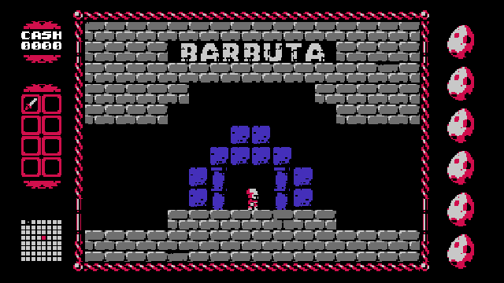

# UFO 50 for Miyoo Mini

UFO 50 for Miyoo Mini and Mini Plus running Onion. You need your own Windows
copy of the game. The download contains the port, so you add the game files
yourself.



[About the capture](docs/media.md)

## Huge thanks to Butterscotch

**This port exists because of [Butterscotch](https://github.com/ButterscotchRunner/Butterscotch).**
Huge shout-out to everyone who built and contributed to the runner. Their work
makes UFO 50 playable here. Thanks also to
[cobaltgit's Onion branch](https://github.com/cobaltgit/Butterscotch/tree/onion-v2),
where this port started.

## Install

1. Enable **Ports Collection** in Onion's Package Manager.
2. Download `ufo50-miyoo-mini-v0.1.1.zip` from
   [Releases](https://github.com/Producdevity/ufo50-miyoo-mini-port/releases/tag/v0.1.1)
   and merge its `Roms` folder into the root of your SD card. Keep your existing
   `Games` and `Shortcuts` folders; overwrite only the UFO50 port files.
3. In Steam, right-click UFO 50 and choose **Manage → Browse local files**.
4. Copy the contents of that Windows game folder into
   **`Roms/PORTS/Games/UFO50/gamefiles/`**. Keep the audio groups, textures, fonts
   and `ext` folders together. You do not need the Windows executable.
5. Run **~Import ports**, then open **Action → UFO50**.

The game files should look like this:

```text
Roms/PORTS/Games/UFO50/gamefiles/
  data.win
  audiogroup_sfx.dat
  textures/
  fonts/
  ext/
```

Copy **every `audiogroup*.dat` file** alongside `data.win`. The texture folder
can be named `textures` or `Textures`.

`data.win` must be directly inside `gamefiles`. A ZIP or an extra UFO50 folder
inside it will not work. Game files are not included in the download.

## Controls and saves

| Button | Action |
| --- | --- |
| D-pad | Move / select |
| A or Y | First action / confirm |
| B or X | Second action |
| Start | Pause menu |
| Select | Back / menu |

Use the game's menus to return to the library and quit. Saves are in
`Saves/CurrentProfile/saves/UFO50`. Back them up before updating.

UFO 50 uses a 16:9 picture. Black bars on the Mini's 4:3 screen are normal.
For scanlines, open **Pause → Settings → Video Settings → CRT Effect** and
choose **Soft** or **Hard**. **Off** keeps the normal picture.

The port targets 30 FPS. Heavier games can run slower.

## Problems and source

If startup stalls for 60 seconds, the launcher stops it and shows an error.
Missing or incomplete game files also get an error message. Recopy the whole
Windows game folder, including `textures`, `ext`, and every audio group.

If your computer says the SD card's `Games` folder is corrupt, stop the copy,
back up the card, and check it for filesystem errors. The release doesn't
replace that folder. You can copy just `Games/UFO50` and
`Shortcuts/Action/UFO50.notfound` into the matching folders under `Roms/PORTS`.

[Open an issue](https://github.com/Producdevity/ufo50-miyoo-mini-port/issues)
with your Mini model, Onion version and the latest log from
`Saves/CurrentProfile/saves/UFO50/logs`.

Build instructions are in [CONTRIBUTING.md](CONTRIBUTING.md). Source is
AGPL-3.0; see [LICENSE](LICENSE), [NOTICE](NOTICE) and
[third-party licenses](licenses/THIRD_PARTY.txt). Each release includes its
matching source archive. UFO 50 is made by Mossmouth and its creators; the game
is not distributed here.
